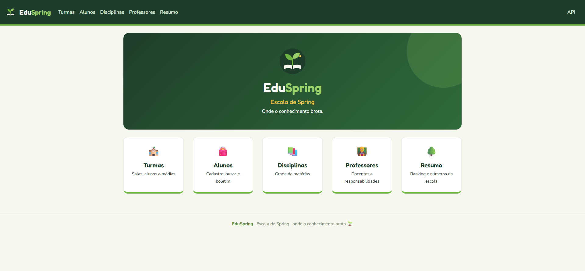
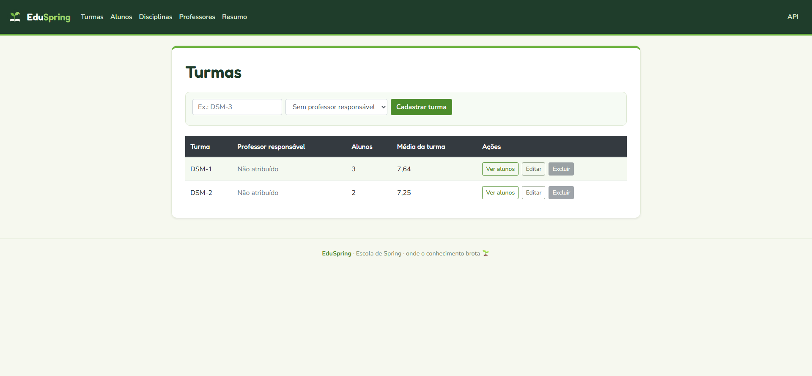
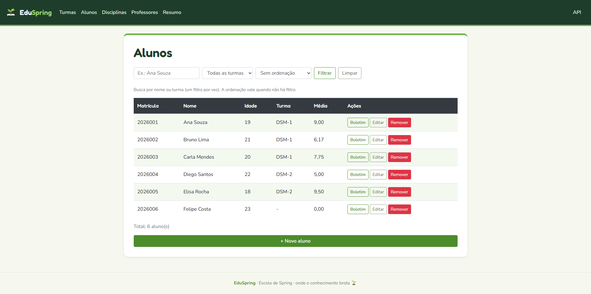
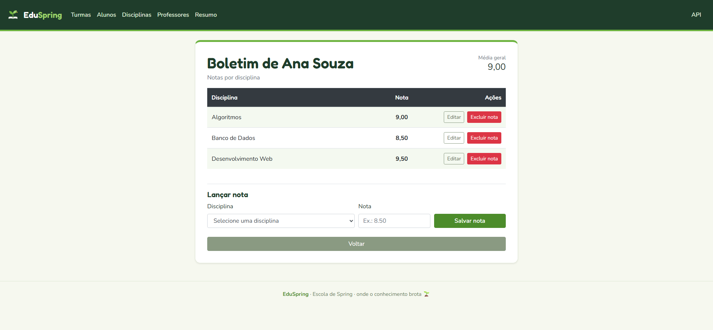
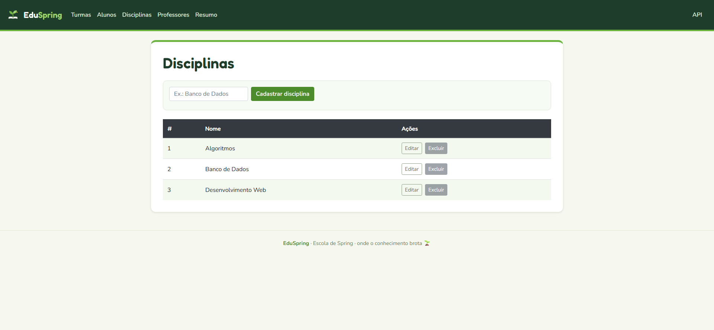
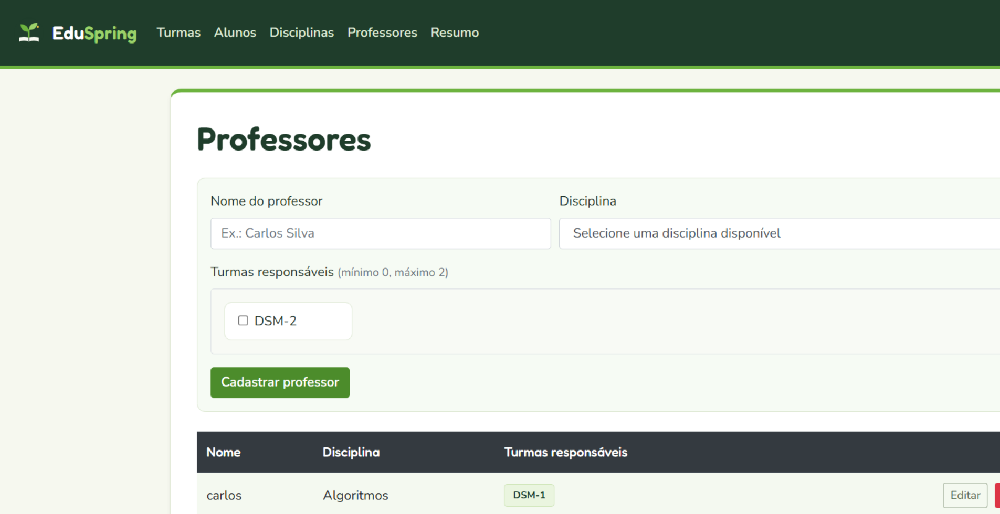
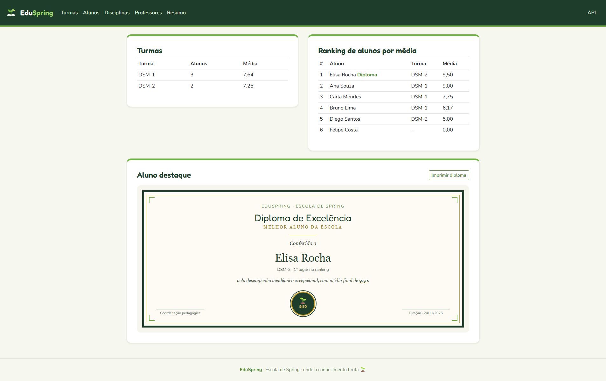
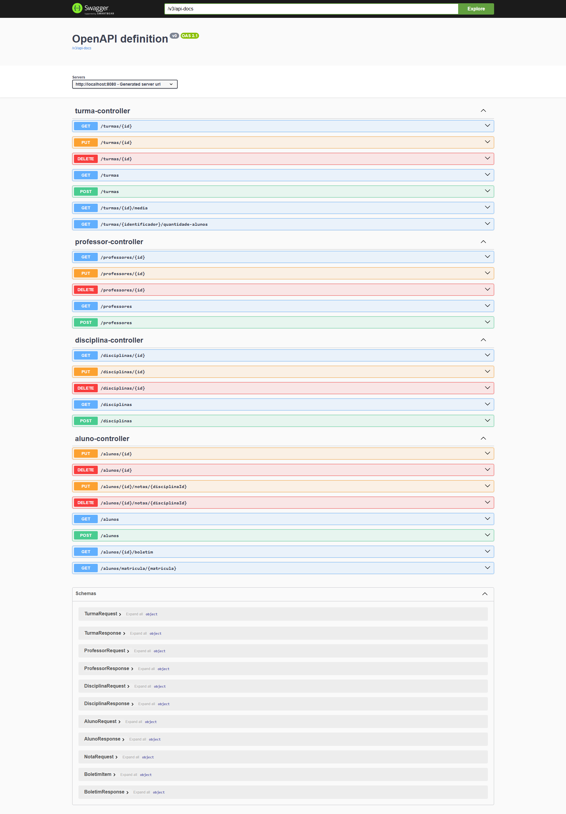
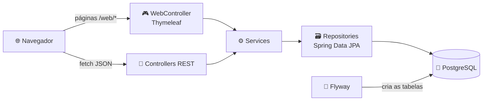
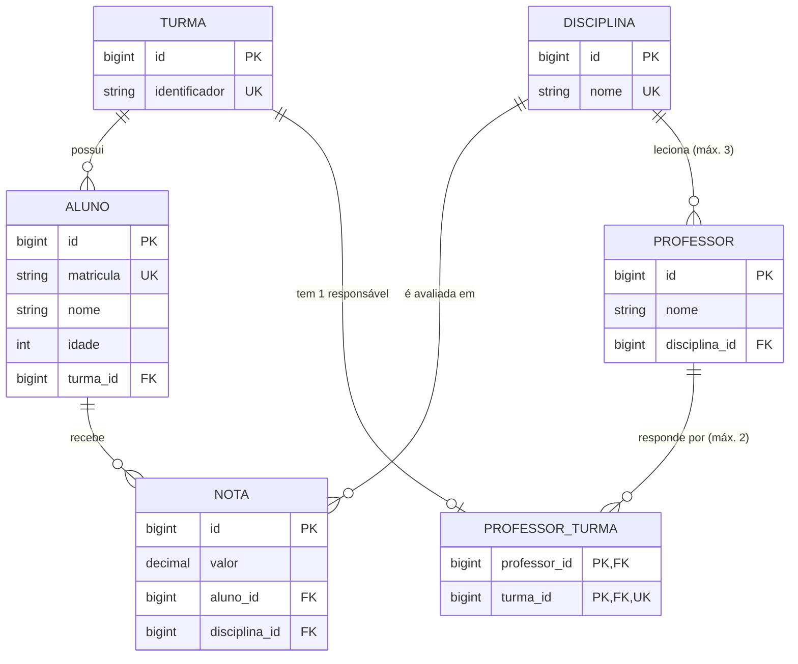

<div align="center">


# 🌱 EduSpring

### Escola de Spring: onde o conhecimento brota

API REST + painel web para gerenciar **turmas, alunos, disciplinas, professores e notas**


🏫 **Turmas** &nbsp;•&nbsp; 🎒 **Alunos** &nbsp;•&nbsp; 📚 **Disciplinas** &nbsp;•&nbsp; 👨‍🏫 **Professores** &nbsp;•&nbsp; 📝 **Boletim** &nbsp;•&nbsp; 🌳 **Ranking**

*Projeto Spring Boot + PostgreSQL • FATEC Praia Grande • DSM*

</div>

---

## 📑 Sumário

- [Sobre o projeto](#-sobre-o-projeto)
- [Telas](#️-telas)
- [Tecnologias](#️-tecnologias)
- [Arquitetura](#️-arquitetura)
- [Como executar](#-como-executar)
- [Páginas](#-páginas)
- [API REST](#-api-rest)
- [Regras de negócio](#-regras-de-negócio)
- [Testes](#-testes)
- [Identidade visual](#-identidade-visual)
- [Limitações e próximos passos](#️-limitações-conhecidas)

---

## 📌 Sobre o projeto

O **EduSpring** é um sistema de gerenciamento escolar. Ele cadastra turmas, alunos, disciplinas e **professores**, lança notas, calcula a **média de cada aluno e de cada turma** e mostra um **ranking** por desempenho.

O backend é uma **API REST em Spring Boot** com **PostgreSQL**, documentada com **Swagger**. O frontend usa **Thymeleaf** para as páginas e **JavaScript `fetch`** para consumir a API REST na tela de resumo.

> 💡 **Destaque da modelagem:** a nota não fica dentro da disciplina. A entidade `Nota` liga um aluno a uma disciplina, então a mesma disciplina serve para todos os alunos sem ser duplicada.

> 👨‍🏫 **Professores:** cada professor leciona **uma disciplina** e pode ser responsável por **até 2 turmas**. Cada turma tem **no máximo 1 professor responsável** e cada disciplina comporta **até 3 professores**. Os limites são validados no service e, no caso da turma, também garantidos no banco (`UNIQUE`).

---

## 🖼️ Telas

### 🏠 Início e 🏫 Turmas

| 🏠 Início | 🏫 Turmas |
|---|---|
|  |  |

### 🎒 Alunos e 📝 Boletim

| 🎒 Alunos | 📝 Boletim |
|---|---|
|  |  |

### 📚 Disciplinas e 👨‍🏫 Professores

| 📚 Disciplinas | 👨‍🏫 Professores |
|---|---|
|  |  |

### 🌳 Resumo e 📖 Swagger

| 🌳 Resumo | 📖 Swagger |
|---|---|
|  |  |

---

## 🛠️ Tecnologias

| Tecnologia | Uso |
|---|---|
| ☕ **Java 17** | Linguagem |
| 🍃 **Spring Boot 4.1.2** | Framework |
| 🗄️ **Spring Data JPA / Hibernate** | Persistência (queries nativas, derivadas e JPQL) |
| 🐘 **PostgreSQL** | Banco de dados relacional |
| 🛫 **Flyway** | Versionamento do esquema do banco (`V1` e `V2`) |
| ✅ **Bean Validation** | Validação de entrada |
| 📖 **springdoc-openapi 3.0** | Documentação Swagger |
| 🌿 **Thymeleaf** | Páginas renderizadas no servidor |
| 🎨 **Bootstrap 4.6** | Estilo (via CDN) |
| 🧰 **Lombok** | Redução de código repetitivo |
| 🧪 **JUnit 5 + H2** | Testes (H2 em memória só no escopo de teste) |

---

## 🏗️ Arquitetura



### 🧱 Modelo de dados



### 📁 Estrutura de pastas

```
src/main/java/br/edu/fatecpg/eduspring/
├── 🚀 EduSpringApplication.java
├── 📦 model/        Turma, Aluno, Disciplina, Nota, Professor
├── 🗃️ repository/   queries nativa, derivadas e JPQL
├── ⚙️ service/      regras e transações
├── 🎮 controller/   REST (@RestController) e páginas (WebController)
├── 📨 dto/          records da API e forms do Thymeleaf
├── 🚨 exception/    NegocioException e ErroHandler
├── 🔤 util/         TextoUtils (limpeza e comparação de textos)
└── 🔧 config/       CORS e carga de dados de exemplo

src/main/resources/
├── 🛫 db/migration/ V1__criar_tabelas.sql, V2__criar_tabela_professor.sql
├── 🌿 templates/    páginas Thymeleaf
├── 🎨 static/       css, js (máscaras dos campos) e logo
└── ⚙️ application.properties

docs/                🖼️ prints das telas usados neste README
```

---

## 🚀 Como executar

**Pré-requisitos:** JDK 17+ e PostgreSQL 16+ rodando na porta `5432`. O Maven não precisa estar instalado, o projeto inclui o `mvnw`.

**1️⃣ Clone o repositório**
```bash
git clone https://github.com/niludev02/EduSpring.git
cd EduSpring
```

**2️⃣ Crie o banco**
```sql
CREATE DATABASE eduspring;
```

**3️⃣ Configure a conexão**

O padrão é usuário `postgres` e senha `postgres`. Se a sua senha for outra, defina a variável de ambiente antes de rodar (a senha não fica no código):

```bash
# Windows (PowerShell)
$env:DB_PASSWORD="sua_senha"

# Linux / macOS
export DB_PASSWORD="sua_senha"
```

Opcionalmente, `DB_USER` troca o usuário. Na IDE, use *Run → Edit Configurations → Environment variables*.

**4️⃣ Execute**
```bash
./mvnw spring-boot:run
```
> 🪟 No Windows: `mvnw.cmd spring-boot:run`, ou rode a classe `EduSpringApplication` pela IDE.

🎉 Pronto! O Flyway cria as tabelas e a aplicação carrega **2 turmas, 3 disciplinas e 6 alunos com notas** de exemplo quando o banco está vazio. Os professores não vêm de exemplo: cadastre pela tela **Professores**.

| O quê | Endereço |
|---|---|
| 🏠 Aplicação | http://localhost:8080 |
| 📖 Swagger (documentação da API) | http://localhost:8080/swagger-ui.html |

<details>
<summary>🩺 <b>Deu erro? Veja as soluções comuns</b></summary>

| Erro | Solução |
|---|---|
| `password authentication failed` | A senha do Postgres não confere. Defina `DB_PASSWORD`. |
| `Connection refused` | O PostgreSQL não está rodando ou não está na porta 5432. |
| `database "eduspring" does not exist` | Crie o banco (passo 2). |
| `Schema-validation: missing table` ou erro do Flyway | Banco com tabelas antigas (sem a tabela de professor, por exemplo). Recrie: `DROP DATABASE eduspring; CREATE DATABASE eduspring;` |
| `Port 8080 was already in use` | Finalize a outra execução ou defina `server.port=8081`. |
| Getters/setters "não existem" na IDE | Ative *Settings → Build → Compiler → Annotation Processors → Enable annotation processing* (Lombok). |

</details>

---

## 🌐 Páginas

| Página | Rota | O que faz |
|---|---|---|
| 🏠 Início | `/` | Atalhos para as áreas do sistema |
| 🏫 Turmas | `/web/turmas` | Lista com quantidade de alunos, média e professor responsável. Cadastro, edição e remoção |
| 🎒 Alunos | `/web/alunos` | Busca por nome, filtro por turma, ordenação por idade ou média, cadastro, edição e remoção |
| 📝 Boletim | `/web/alunos/{id}/boletim` | Notas do aluno, média, lançamento e remoção de nota |
| 📚 Disciplinas | `/web/disciplinas` | Lista, cadastro, edição e remoção |
| 👨‍🏫 Professores | `/web/professores` | Cadastro, edição e remoção. Escolha da disciplina e de até 2 turmas responsáveis |
| 🌳 Resumo | `/web/resumo` | Ranking e contagem por turma, buscados por `fetch` na API REST |

Os formulários seguem o padrão **Post/Redirect/Get**, com validação no servidor e mensagens de erro nos campos.

No formulário de professor, a lista de disciplinas mostra só as que ainda têm vaga (menos de 3 professores) e a lista de turmas mostra só as que estão sem responsável. Na edição, a disciplina e as turmas atuais do professor continuam aparecendo.

---

## 🔌 API REST

| Método | Rota | Descrição |
|---|---|---|
| `GET` `POST` | `/turmas` | Listar e cadastrar turmas (`professorId` opcional) |
| `GET` `PUT` `DELETE` | `/turmas/{id}` | Buscar, editar e remover turma |
| `GET` | `/turmas/{id}/media` | Média da turma |
| `GET` | `/turmas/{identificador}/quantidade-alunos` | Quantidade de alunos (query nativa) |
| `GET` `POST` | `/alunos` | Listar (`?nome=`, `?turma=`, `?ordem=idade\|media`) e cadastrar |
| `GET` | `/alunos/matricula/{matricula}` | Buscar por matrícula |
| `PUT` `DELETE` | `/alunos/{id}` | Editar e remover |
| `GET` | `/alunos/{id}/boletim` | Boletim do aluno |
| `PUT` `DELETE` | `/alunos/{id}/notas/{disciplinaId}` | Lançar/alterar e remover nota |
| `GET` `POST` | `/disciplinas` | Listar e cadastrar disciplinas |
| `GET` `PUT` `DELETE` | `/disciplinas/{id}` | Buscar, editar e remover disciplina |
| `GET` `POST` | `/professores` | Listar e cadastrar professores |
| `GET` `PUT` `DELETE` | `/professores/{id}` | Buscar, editar e remover professor |

Exemplo de cadastro de professor:

```http
POST /professores
Content-Type: application/json

{
  "nome": "Carlos Silva",
  "disciplinaId": 1,
  "turmaIds": [1, 2]
}
```

```json
{
  "id": 1,
  "nome": "Carlos Silva",
  "disciplinaId": 1,
  "disciplina": "Algoritmos",
  "turmaIds": [1, 2],
  "turmas": ["DSM-1", "DSM-2"]
}
```

Os erros voltam em JSON, com o status HTTP correto:

```json
{ "status": 409, "mensagem": "Matrícula já cadastrada", "detalhes": [] }
```

| Status | Quando |
|---|---|
| `400` | Dados inválidos (nota fora de 0 a 10, campo obrigatório vazio, professor com mais de 2 turmas) |
| `404` | Aluno, turma, disciplina ou professor não encontrados |
| `409` | Registro duplicado ou limite atingido (matrícula, turma, disciplina, nome de professor, 3 professores por disciplina, turma que já tem responsável) |

---

## 🧠 Regras de negócio

### 📝 Notas e médias

| Regra | Onde |
|---|---|
| A nota deve estar entre **0 e 10** | `Nota.atribuirNota` |
| O aluno não pode ter a mesma disciplina duas vezes | `Aluno.adicionarDisciplina` |
| Média do aluno = média das notas lançadas (0 se não houver notas) | `Aluno.calcularMedia` |
| Média da turma = média das médias dos alunos que têm nota | `Turma.calcularMediaTurma` |
| Matrícula, identificador da turma e nome da disciplina são únicos | Banco e services |

### 👨‍🏫 Professores

| Regra | Onde |
|---|---|
| Nome e disciplina são obrigatórios (nome com até 150 caracteres) | `ProfessorRequest` |
| Cada professor leciona **1 disciplina** | `Professor.disciplina` |
| Uma disciplina tem **no máximo 3 professores** | `ProfessorService.validarRelacoes` |
| Um professor é responsável por **no máximo 2 turmas** | `ProfessorService.validarRelacoes` e `TurmaService` |
| Uma turma tem **no máximo 1 professor responsável** | `UNIQUE (turma_id)` em `professor_turma` e services |
| Não pode haver dois professores com o mesmo nome, ignorando maiúsculas, acentos e espaços | `TextoUtils.equivalentes` |
| Não é possível excluir turma com alunos ou com professor responsável | `TurmaService.remover` |
| Não é possível excluir disciplina com notas ou com professores vinculados | `DisciplinaService.remover` |
| Ao excluir um professor, os vínculos com as turmas são removidos (`ON DELETE CASCADE`) | Migration `V2` |

## 🔎 Consultas do repositório

| Tipo | Método | Usado em |
|---|---|---|
| 🟦 Nativa | `contarAlunosPorTurma` | `/turmas/{identificador}/quantidade-alunos` |
| 🟦 Nativa | `contarResponsaveisPorTurma` | Garantir 1 professor por turma |
| 🟩 Derivada | `findByMatricula`, `findByNomeContainingIgnoreCase`, `findByTurmaIdentificador` | Buscas e filtros de alunos |
| 🟩 Derivada | `countByDisciplinaId`, `findByTurmasId` | Limite de 3 professores por disciplina e professor da turma |
| 🟧 JPQL | `listarOrdenadosPorIdade`, `listarOrdenadosPorMedia` | Ordenação e ranking |
| 🟧 JPQL | `listarComTurmas` (`LEFT JOIN FETCH`) | Listar professores com as turmas, sem N+1 |

---

## 🧪 Testes

```bash
./mvnw test
```

Testes unitários das regras de `Aluno`, `Nota` e `Turma` (média, limites da nota, disciplina duplicada e aluno duplicado na turma) e do utilitário `TextoUtils` (limpeza de espaços e comparação sem acentos). Há também um teste de carga do contexto, que usa H2 em memória.

---

## 🎨 Identidade visual

O logo é um livro aberto de onde brota uma planta, referência ao verde do Spring e à educação como crescimento.

| Cor | Hex | Uso |
|---|---|---|
| 🟢 Verde Spring | `#6DB33F` | Destaques e bordas |
| 🌿 Verde escuro | `#4C8C2B` | Botões e links |
| 🍃 Verde claro | `#9BD16A` | Detalhes do logo e do título |
| 🌲 Verde floresta | `#1F3D2B` | Navbar, tabelas e títulos |
| 🥛 Creme | `#F6F8EF` | Fundo |
| ☀️ Amarelo sol | `#F4C542` | Acento e hover |

Fontes: **Fredoka** (títulos) e **Nunito** (texto).

---

## ⚠️ Limitações conhecidas

- Os filtros da lista de alunos funcionam um por vez (nome ou turma), e a ordenação vale sem filtro.
- Ainda não há testes de repositório (`@DataJpaTest` / Testcontainers) nem testes do `ProfessorService`.
- Não há autenticação nem paginação.

## 🔮 Próximos passos

- [ ] Testes do `ProfessorService` (limites de 3 por disciplina e 2 turmas por professor)
- [ ] Testes de repositório com banco real
- [ ] Situação do aluno (aprovado, recuperação, reprovado) pela média
- [ ] Paginação das listagens
- [ ] Combinar filtros na busca de alunos

---

<div align="center">

⭐ Se curtiu o projeto, deixa uma estrela!

</div>